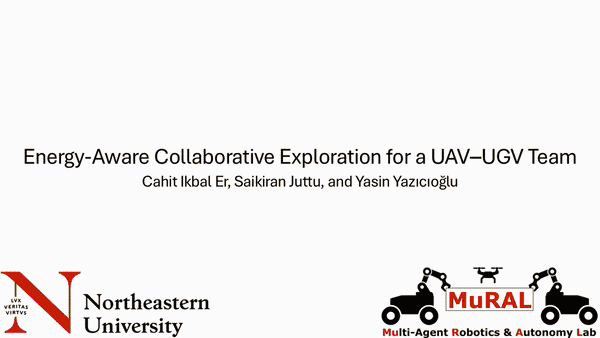

# Energy-Aware Collaborative Exploration for a UAV–UGV Team

[](https://arxiv.org/abs/2603.22507)
[](https://arxiv.org/abs/2603.22507)
[](https://youtu.be/_oIx-_JZMKk)

Code and Gazebo simulation for our IROS 2026 paper, including the proposed planner and the
variants used in our benchmark comparisons. Developed at the
[Multi-Agent Robotics and Autonomy Lab](https://github.com/Multi-Agent-Robotics-and-Autonomy-Lab),
Northeastern University.

## Abstract

We present an energy-aware collaborative exploration framework for a UAV-UGV team operating
in unknown environments, where the UAV's energy constraint is modeled as a maximum
flight-time limit. The UAV executes a sequence of energy-bounded exploration tours, while the
UGV simultaneously explores on the ground and serves as a mobile charging station.
Rendezvous is enforced under a shared time budget so that the vehicles meet at the end of
each tour before the UAV reaches its flight-time limit. We construct a sparsely coupled
air-ground roadmap using a density-aware layered probabilistic roadmap (PRM) and formulate
tour selection over the roadmap as coupled orienteering problems (OPs) to maximize
information gain subject to the rendezvous constraint. The resulting tours are constructed
over collision-validated roadmap edges. We validate our method through simulation studies,
benchmark comparisons, and real-world experiments.

<p align="center">
  
</p>

<p align="center"><em>Simulation and hardware experiments. Full video on <a href="https://youtu.be/_oIx-_JZMKk">YouTube</a>.</em></p>

## How it works

1. **Build the roadmap.** The UGV's LiDAR is fused into the UAV's occupancy map. Over the
   current map, a density-aware layered PRM builds a sparsely coupled air–ground roadmap
   whose edges are collision-checked.
2. **Select the tours.** Each round, one UAV tour and one UGV tour are chosen by solving
   coupled orienteering problems that maximize information gain. Both tours must end at a
   common rendezvous point within a shared time budget, before the UAV reaches its
   flight-time limit.
3. **Explore and meet.** Both robots execute their tours at the same time. At the
   rendezvous, the UAV lands on a platform mounted on the UGV.
4. **Recharge and repeat.** The UAV recharges on the UGV, and the next round is planned on
   the updated map.

The UGV can enter passages the UAV cannot fly through, and the UAV can reach elevated
structures the UGV cannot climb, so neither robot alone covers the test environments.
Module-level design is described in [`docs/ARCHITECTURE.md`](docs/ARCHITECTURE.md).

## Requirements

- Ubuntu 20.04 with ROS Noetic
- Gazebo 11 (included in `ros-noetic-desktop-full`)
- A GPU is recommended. Results in the paper were produced on an i9-14900K with an RTX 4090.

`main` is the ROS Noetic version used for the paper. A ROS 2 port is in progress on the
`ros2` branch.

<details>
<summary><b>Install dependencies</b></summary>

```bash
sudo apt update
sudo apt install -y \
  ros-noetic-desktop-full \
  ros-noetic-octomap ros-noetic-octomap-ros ros-noetic-octomap-msgs \
  ros-noetic-octomap-server ros-noetic-octomap-rviz-plugins \
  ros-noetic-mavros ros-noetic-mavros-extras ros-noetic-mavros-msgs \
  ros-noetic-vision-msgs \
  ros-noetic-velodyne-simulator ros-noetic-velodyne-description \
  ros-noetic-velodyne-gazebo-plugins \
  ros-noetic-gazebo-ros-pkgs ros-noetic-gazebo-ros-control ros-noetic-gazebo-plugins \
  ros-noetic-controller-manager ros-noetic-velocity-controllers \
  ros-noetic-joint-state-controller ros-noetic-joint-state-publisher-gui \
  ros-noetic-robot-state-publisher \
  ros-noetic-move-base ros-noetic-costmap-2d ros-noetic-costmap-converter \
  ros-noetic-teb-local-planner ros-noetic-dwa-local-planner \
  ros-noetic-base-local-planner \
  ros-noetic-gmapping ros-noetic-openslam-gmapping ros-noetic-fake-localization \
  ros-noetic-pointcloud-to-laserscan ros-noetic-pcl-ros ros-noetic-nodelet-core \
  ros-noetic-twist-mux ros-noetic-roslint ros-noetic-xacro ros-noetic-topic-tools \
  libeigen3-dev libpcl-dev libopencv-dev libprotobuf-dev protobuf-compiler \
  qtbase5-dev libboost-all-dev
```

`ros-noetic-velodyne-simulator` is required: the Scout Mini URDF depends on
`velodyne_description`.

</details>

## Build

```bash
git clone https://github.com/Multi-Agent-Robotics-and-Autonomy-Lab/uav-ugv-collaborative-exploration.git
cd uav-ugv-collaborative-exploration
source /opt/ros/noetic/setup.bash
catkin_make -DCMAKE_BUILD_TYPE=Release
```

Use `catkin_make`, not `catkin build`. Then, in every terminal you open:

```bash
source setup_env.sh
```

This sources ROS and the workspace and puts this workspace first on the Gazebo plugin and
model paths (see [Troubleshooting](#troubleshooting)).

## Running the demo

Open four terminals and run `source setup_env.sh` in each one first.

```bash
# Terminal 1: Gazebo world, UAV, UGV, SLAM and UGV navigation
roslaunch uav_simulator try.launch
# Gazebo starts paused. Press play once both robots are visible.

# Terminal 2: fuse the UGV's LiDAR into the UAV's occupancy map
roslaunch map_manager map_fusion.launch

# Terminal 3: mission coordinator (also starts the planner)
roslaunch uav_ugv_coordinator uav_ugv_coordinator.launch

# Terminal 4: visualization
roslaunch remote_control exploration_rviz.launch
```

The UAV takes off and performs a 360° scan to initialize the map. The team then repeats the
plan, execute, rendezvous and recharge cycle. Terminal 3 reports progress with messages such
as `[Coordinator] Requesting New Plans`, `[Coordinator] Received BOTH paths` and
`[Coordinator] Touchdown Confirmed`.

> [!NOTE]
> The coordinator runs its own exploration stack. Do not launch
> `autonomous_flight dynamic_exploration.launch` alongside it.

### Environments

```bash
roslaunch uav_simulator try.launch wname:=heterogenous_arena
```

| World | |
|---|---|
| `construction_site_big_v` | default |
| `construction_site_big` | |
| `custom_arena` | |
| `heterogenous_arena` | |
| `heterogenous_large_arena` | |
| `simple_maze` | |

Worlds are in `src/CERLAB-UAV-Autonomy/uav_simulator/worlds/floorplan3/`.

> [!IMPORTANT]
> When switching worlds, also update `total_voxels` in `dep.cpp` and the PRM sampling
> bounds. Otherwise coverage percentages and sampling will be wrong. See
> [`docs/PARAMETERS.md`](docs/PARAMETERS.md#switching-environments).

Other `try.launch` arguments: `planner:=teb|dwa|base`, `paused:=false`, `gui:=false`,
`debug:=true` (runs gzserver under gdb).

### Single robot

```bash
# UAV only
roslaunch uav_simulator start.launch
roslaunch remote_control exploration_rviz.launch
roslaunch autonomous_flight dynamic_exploration.launch

# UGV only (send goals with "2D Nav Goal" in RViz)
roslaunch scout_gazebo_sim scout_mini_playpen.launch wname:=example planner:=teb
```

## Parameters

| Location | Examples | Rebuild needed |
|---|---|---|
| Launch file arguments and `<param>` tags | `wname`, `planner`, `scan_hold_sec`, `reach_tol_xyz` | No |
| YAML files in `autonomous_flight/cfg/dynamic_exploration/` | PRM bounds, node spacing, clearances, flight speeds | No |
| Constants in `dep.cpp` / `dep.h` | `total_voxels`, `lambda`, time budgets, UGV sensor model | Yes |

[`docs/PARAMETERS.md`](docs/PARAMETERS.md) lists every parameter with its file, line, and
corresponding entry in Table I of the paper.

## Benchmarks

The planner is selected at build time:

```bash
catkin_make -DCMAKE_BUILD_TYPE=Release -DDEP_VARIANT=dep_uav.cpp
```

| `DEP_VARIANT` | Planner |
|---|---|
| `dep.cpp` (default) | Proposed method: coupled air–ground PRM with coupled OPs |
| `dep_uav.cpp` | Single UAV, without the UGV |
| `dep_benchmarking.cpp` | Baseline used in the benchmark comparisons |

See [`docs/BENCHMARKS.md`](docs/BENCHMARKS.md) for details.

## Repository layout

```
setup_env.sh                  environment setup, source in every terminal
docs/                         architecture, parameters, benchmarks, media
src/
  CERLAB-UAV-Autonomy/
    uav_ugv_coordinator/      mission state machine for the UAV–UGV team
    global_planner/           dep.cpp: layered PRM and coupled OP planner
    map_manager/              occupancy map and UGV map fusion
    autonomous_flight/        UAV flight stack
    uav_simulator/            Gazebo UAV model, plugins and worlds
    trajectory_planner/       B-spline trajectory generation
    tracking_controller/      UAV trajectory tracking
    time_optimizer/           time-optimal reparameterization
    onboard_detector/         dynamic obstacle detection (not used here)
    remote_control/           RViz configurations
  scout_control/              UGV move_base, costmap and TEB parameters
  scout_description/          Scout Mini URDF with landing platform
  scout_gazebo_sim/           Scout Mini Gazebo launch files
```

## Troubleshooting

<details>
<summary><b>A robot is missing or misplaced after launch</b></summary>

Robots sometimes fail to spawn correctly, especially after a fresh build. Stop with
`Ctrl+C` and relaunch `try.launch`; it may take a few attempts.

</details>

<details>
<summary><b>The UAV jumps back to the origin</b></summary>

Another catkin workspace (for example one sourced in `~/.bashrc`) is ahead of this one on
`GAZEBO_PLUGIN_PATH`, so Gazebo loads its quadcopter plugin instead. `setup_env.sh` puts
this workspace first and prints which plugin directory is used. Make sure you sourced it in
the terminal that launches Gazebo.

</details>

<details>
<summary><b><code>No module named 'rospkg'</code> from xacro</b></summary>

A conda environment is active and its Python lacks `rospkg`. `setup_env.sh` deactivates
conda; otherwise run `conda deactivate` before launching.

</details>

## Citation

<!-- TODO: replace with the IROS 2026 entry once the proceedings are published -->

```bibtex
@article{er2026energyaware,
  title   = {Energy-Aware Collaborative Exploration for a {UAV}--{UGV} Team},
  author  = {Er, Cahit Ikbal and Juttu, Saikiran and Yaz{\i}c{\i}o{\u{g}}lu, Yasin},
  journal = {arXiv preprint arXiv:2603.22507},
  year    = {2026}
}
```

A video of the simulations and hardware experiments is on
[YouTube](https://youtu.be/_oIx-_JZMKk).

## License

MIT, see [`LICENSE`](LICENSE).

The UAV stack in `src/CERLAB-UAV-Autonomy` is adapted from
[CERLAB-UAV-Autonomy](https://github.com/Zhefan-Xu/CERLAB-UAV-Autonomy), and the UGV packages
derive from AgileX / Weston Robot `scout_ros`. The repository also includes MOSEK, a
commercial solver not covered by the MIT license. See
[`THIRD_PARTY_NOTICES.md`](THIRD_PARTY_NOTICES.md) before redistributing.
